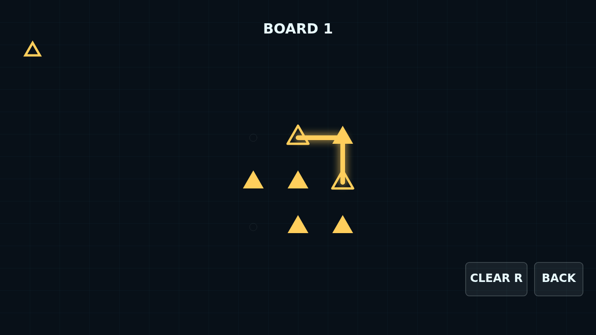
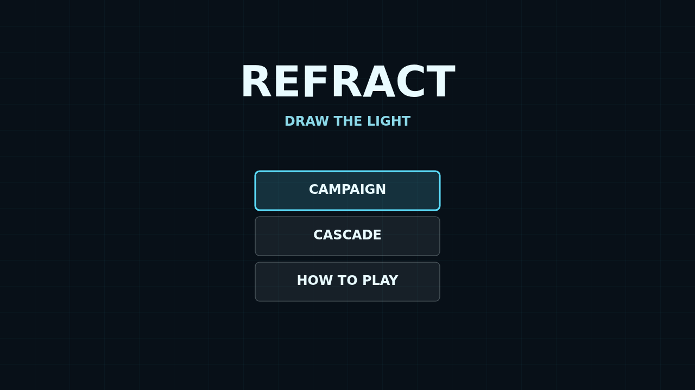

# Refract

Refract is a light-tracing puzzle played on a dark optical bench. Every board is
a small lattice of optical nodes, and your job is to draw clean paths of light
between matching emitters.

Each channel has its own shape and color. Press an emitter, drag through adjacent
nodes, thread every lens of that channel, and finish at the other emitter.
Crystals are shared by all channels, but every charge in them must be spent
exactly once.

The Campaign offers 24 fixed boards that unlock one by one, building from compact
single-channel puzzles into dense three-channel benches. Cascade keeps dealing
new boards forever, climbing through tiers as you solve.

